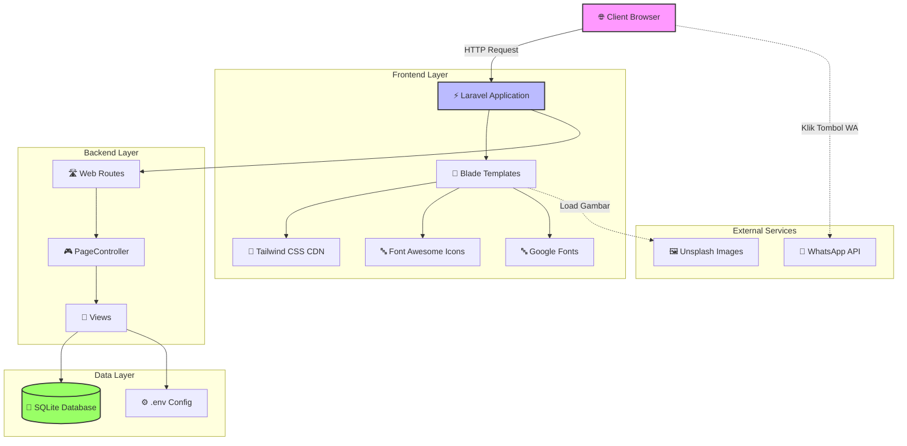
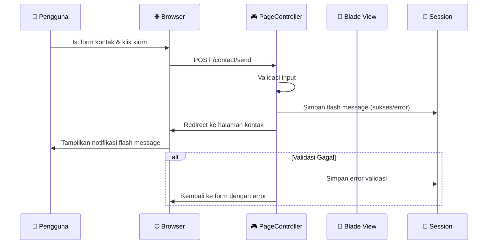
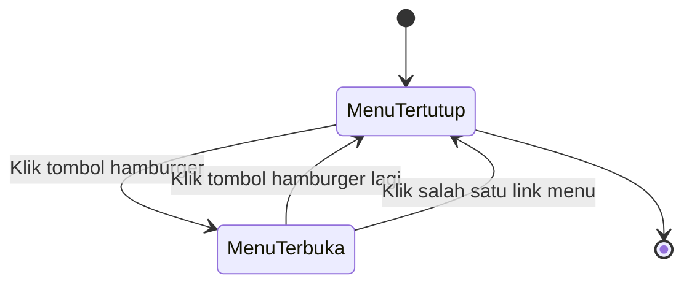

# PT Indonesian Fabrication Global (IFG Corp)

> **Company Profile Website** — Sistem informasi perusahaan resmi untuk PT Indonesian Fabrication Global, spesialis fabrikasi dan erection struktur baja untuk bangunan komersial, industri, dan infrastruktur nasional.

[](https://laravel.com)
[](https://tailwindcss.com)
[](https://php.net)
[](https://sqlite.org)
[](LICENSE)


## 📋 Daftar Isi

- [Tentang Project](#-tentang-project)
- [Fitur Utama](#-fitur-utama)
- [Arsitektur Sistem](#-arsitektur-sistem)
- [Diagram Alur](#-diagram-alur)
- [Struktur Direktori](#-struktur-direktori)
- [Teknologi yang Digunakan](#-teknologi-yang-digunakan)
- [Instalasi & Setup](#-instalasi--setup)
- [Konfigurasi Environment](#-konfigurasi-environment)
- [Routing](#-routing)
- [Deployment](#-deployment)
- [Kontribusi](#-kontribusi)
- [Lisensi](#-lisensi)
- [Kontak](#-kontak)

---

## 🏢 Tentang Project

Website company profile ini dibangun menggunakan **Laravel 12** dengan desain responsif yang dioptimalkan untuk smartphone. Tampilan menggunakan tema **Dark Industrial** dengan aksen warna merah dan biru sebagai brand identity PT Indonesian Fabrication Global.

Website ini berupa **single-page application** (semua section dalam satu halaman) dengan navigasi smooth scroll antar section.

**Bidang Usaha:**
- Fabrikasi Struktur Baja
- Erection Struktur Baja
- Pembuatan & Modifikasi Baja
- Maintenance Struktur Baja

---

## ✨ Fitur Utama

| Fitur | Deskripsi |
|-------|-----------|
| 📱 **Responsive Design** | Tampilan optimal di desktop, tablet, dan smartphone |
| 🎨 **Dark Theme Industrial** | Desain modern dengan latar gelap dan aksen brand |
| 📊 **Single Page** | 8 section dalam satu halaman dengan smooth scroll |
| 📞 **WhatsApp Integration** | Tombol floating WhatsApp dan link kontak langsung |
| 📋 **Contact Form** | Form kirim penawaran proyek dengan validasi |
| 🛡️ **Legalitas** | Halaman dokumen resmi (SK Menkumham, NIB, NPWP) |
| 🖼️ **Portofolio** | Galeri proyek unggulan dengan detail klien dan status |
| ⚡ **Fast Loading** | Menggunakan Tailwind CSS CDN untuk cepat diakses |

---

## 🏗️ Arsitektur Sistem

Berikut adalah arsitektur tinggi dari website company profile IFG Corp:



### Komponen Utama

| Komponen | Tanggung Jawab |
|----------|---------------|
| **Client** | Browser pengguna yang mengakses website |
| **Laravel Application** | Core aplikasi yang menangani routing dan rendering |
| **Blade Templates** | Template engine untuk menampilkan halaman HTML |
| **PageController** | Controller yang mengelola logika setiap halaman |
| **Web Routes** | Definisi rute URL untuk setiap halaman |
| **SQLite** | Database ringan untuk menyimpan data (sessions, dsb) |
| **Tailwind CSS** | Framework CSS untuk styling responsif |

---

## 📊 Diagram Alur

### 1. Alur Navigasi Halaman (Single Page)

```mermaid
graph LR
    Hero[🏠 Hero Section] --> About[🏢 Tentang Perusahaan]
    About --> Visi[🎯 Visi & Misi]
    Visi --> Services[🛠️ Layanan]
    Services --> Method[⚙️ Metode Kerja]
    Method --> Portfolio[📁 Portofolio]
    Portfolio --> Legal[📜 Legalitas]
    Legal --> Contact[📞 Kontak]
    
    style Hero fill:#e52320,color:#fff
    style Contact fill:#0f52ba,color:#fff
    linkStyle default stroke:#2563EB,stroke-width:2px
```



### 2. Alur Request-Response (Contact Form)



### 3. Alur Navigasi Mobile Menu



---

## 📁 Struktur Direktori

```text
C:\xampp\htdocs\ifg_corp\website/
├── app/
│   ├── Http/
│   │   ├── Controllers/
│   │   │   ├── Controller.php
│   │   │   └── PageController.php   # Mengelola semua halaman
│   │   └── Kernel.php
│   ├── Models/
│   └── ...
├── bootstrap/
├── config/
├── database/
│   └── database.sqlite              # SQLite database file
├── public/
│   ├── index.php                    # Entry point
│   └── build/                       # Assets hasil build Vite
├── resources/
│   ├── views/
│   │   ├── components/
│   │   │   └── app-layout.blade.php # Layout utama dengan navbar & footer
│   │   ├── home.blade.php           # Halaman utama (single page, 8 section)
│   │   ├── about.blade.php          # Halaman tentang
│   │   ├── services.blade.php       # Halaman layanan
│   │   ├── portfolio.blade.php      # Halaman portofolio
│   │   └── contact.blade.php        # Halaman kontak
│   ├── css/
│   │   └── app.css
│   └── js/
│       └── app.js
├── routes/
│   └── web.php                      # Definisi semua rute web
├── storage/
├── tests/
├── .env                             # Konfigurasi environment
├── .gitignore
├── composer.json
├── composer.lock
├── package.json
├── postcss.config.js
├── tailwind.config.js
├── vite.config.js
└── artisan
```

---

## 🛠️ Teknologi yang Digunakan

| Teknologi | Versi | Keuntungan |
|-----------|-------|------------|
| **Laravel** | 12.x | PHP framework modern, ecosystem lengkap |
| **PHP** | 8.2+ | Bahasa pemrograman server-side |
| **Tailwind CSS** | 3.x | Utility-first CSS framework, responsif |
| **SQLite** | - | Database file-based, tidak perlu server terpisah |
| **Font Awesome** | 6.4.0 | Ikon vektor untuk UI |
| **Google Fonts** | Montserrat & Inter | Tipografi profesional |
| **Vite** | - | Build tool untuk aset frontend |
| **Blade** | - | Template engine Laravel |

---

## 🚀 Instalasi & Setup

### Prasyarat

Pastikan telah menginstal:
- [XAMPP](https://www.apachefriends.org/) (PHP 8.2+, Apache, MySQL)
- [Composer](https://getcomposer.org/) (versi 2.8+)
- [Node.js & npm](https://nodejs.org/) (opsional, untuk aset frontend)

### Langkah-langkah Instalasi

```bash
# 1. Clone repository
git clone https://github.com/swkcorpmain/ifg.git
cd ifg/website

# 2. Install dependensi PHP
composer install

# 3. Salin file environment
copy .env.example .env   # Windows
# atau
cp .env.example .env     # Linux/Mac

# 4. Generate application key
php artisan key:generate

# 5. Buat file database SQLite (jika belum ada)
type nul > database\database.sqlite   # Windows CMD
# atau
touch database/database.sqlite        # Linux/Mac

# 6. (Opsional) Install dan build aset frontend
npm install
npm run build

# 7. Jalankan server development
php artisan serve

# 8. Akses di browser
# http://localhost:8000
```

### Mengakses Melalui XAMPP (localhost)

Jika ingin mengakses melalui XAMPP tanpa `php artisan serve`:

```text
http://localhost/ifg_corp/website/public/
```

Pastikan folder `website/public` adalah document root atau gunakan virtual host.

---

## ⚙️ Konfigurasi Environment

File `.env` di root project berisi konfigurasi utama:

```env
APP_NAME="PT Indonesian Fabrication Global"
APP_ENV=local
APP_KEY=base64:...
APP_DEBUG=true
APP_URL=http://localhost:8000

DB_CONNECTION=sqlite
DB_DATABASE=/absolute/path/to/database/database.sqlite

MAIL_MAILER=smtp
MAIL_HOST=your-smtp-host
MAIL_PORT=587
MAIL_USERNAME=your-email
MAIL_PASSWORD=your-password
MAIL_ENCRYPTION=tls
MAIL_FROM_ADDRESS="hello@ifg-corp.com"
MAIL_FROM_NAME="${APP_NAME}"
```

> **Catatan:** Untuk mengirim email dari form kontak, konfigurasikan `MAIL_*` di file `.env` dan gunakan `Mail::send()` di controller.

---

## 🛣️ Routing

| Method | URI | Action | Deskripsi |
|--------|-----|--------|-----------|
| GET | `/` | `PageController@home` | Halaman beranda (single page) |
| GET | `/about` | `PageController@about` | Halaman tentang perusahaan |
| GET | `/services` | `PageController@services` | Halaman layanan |
| GET | `/portfolio` | `PageController@portfolio` | Halaman portofolio |
| GET | `/contact` | `PageController@contact` | Halaman kontak |
| POST | `/contact/send` | `PageController@sendContact` | Proses kirim form kontak |

Semua halaman menggunakan layout yang sama (`app-layout.blade.php`) dengan navbar dan footer konsisten.

---

## 🚀 Deployment

### Produksi dengan Apache/Nginx

1. Pastikan `composer install --optimize-autoloader --no-dev` telah dijalankan
2. Set `APP_ENV=production` dan `APP_DEBUG=false` di `.env`
3. Jalankan `php artisan config:cache` dan `php artisan route:cache`
4. Pastikan folder `storage` dan `bootstrap/cache` memiliki izin tulis
5. Arahkan document root web server ke folder `public/`

### Contoh Virtual Host Apache

```apache
<VirtualHost *:80>
    ServerName ifg-corp.com
    DocumentRoot "C:/xampp/htdocs/ifg_corp/website/public"

    <Directory "C:/xampp/htdocs/ifg_corp/website/public">
        AllowOverride All
        Require all granted
    </Directory>
</VirtualHost>
```


---

## 🤝 Kontribusi

Kontribusi sangat diterima! Silakan ikuti langkah berikut:

1. Fork repository ini
2. Buat branch fitur: `git checkout -b fitur/nama-fitur`
3. Commit perubahan: `git commit -m "Add: deskripsi fitur"`
4. Push ke branch: `git push origin fitur/nama-fitur`
5. Buat Pull Request

### Pedoman Commit

Gunakan format:
```
<tipe>: <deskripsi singkat>

Contoh:
feat: tambah halaman portofolio
fix: perbaiki tampilan mobile menu
docs: update README arsitektur
```

---

## 📄 Lisensi

Project ini dilisensikan di bawah lisensi [MIT](LICENSE). Silakan lihat file `LICENSE` untuk informasi lebih lanjut.

---

## 📞 Kontak

**PT Indonesian Fabrication Global**

- 📧 Email: indonesianfabricationglobal@gmail.com
- 📱 WhatsApp: 081315419958
- 📍 Alamat: Jl. Pawon Raya No 24 Perumnas II, Karawaci, Tangerang, Banten
- 📸 Instagram: @indonesianfabricationglobal

---

Made with ❤️ by PT Indonesian Fabrication Global | 2026
